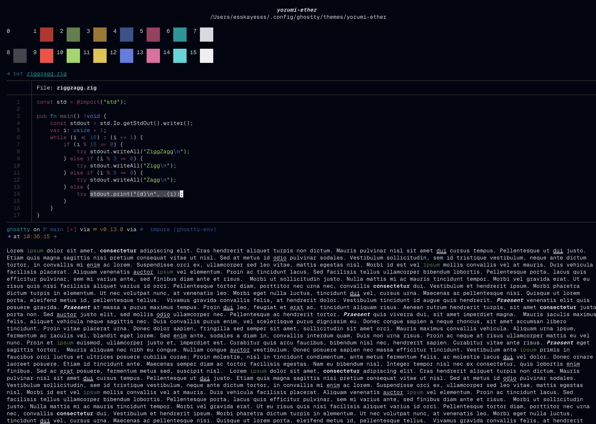
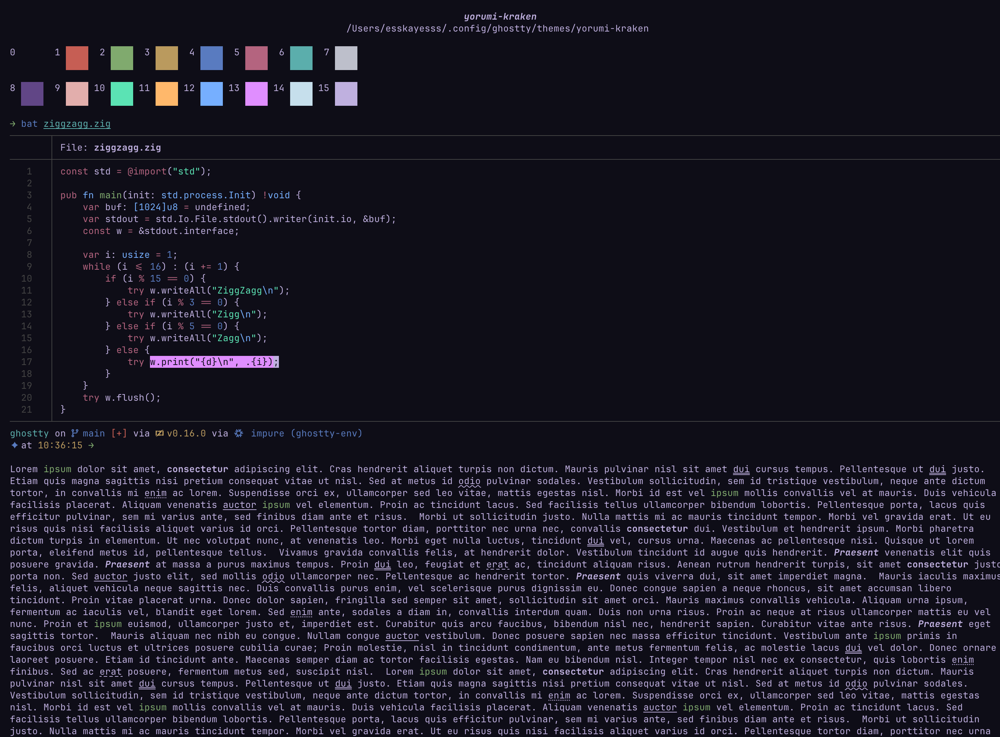
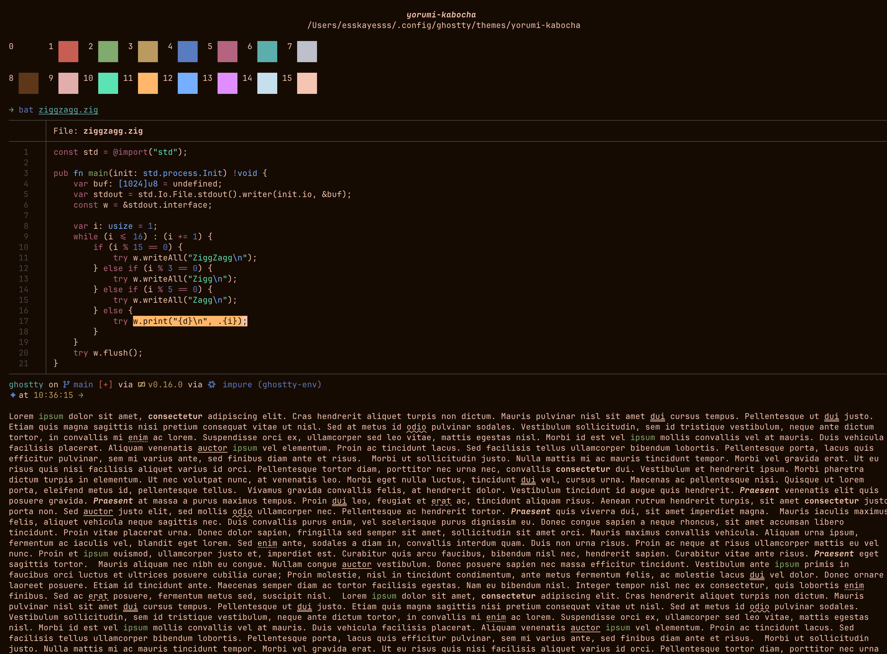
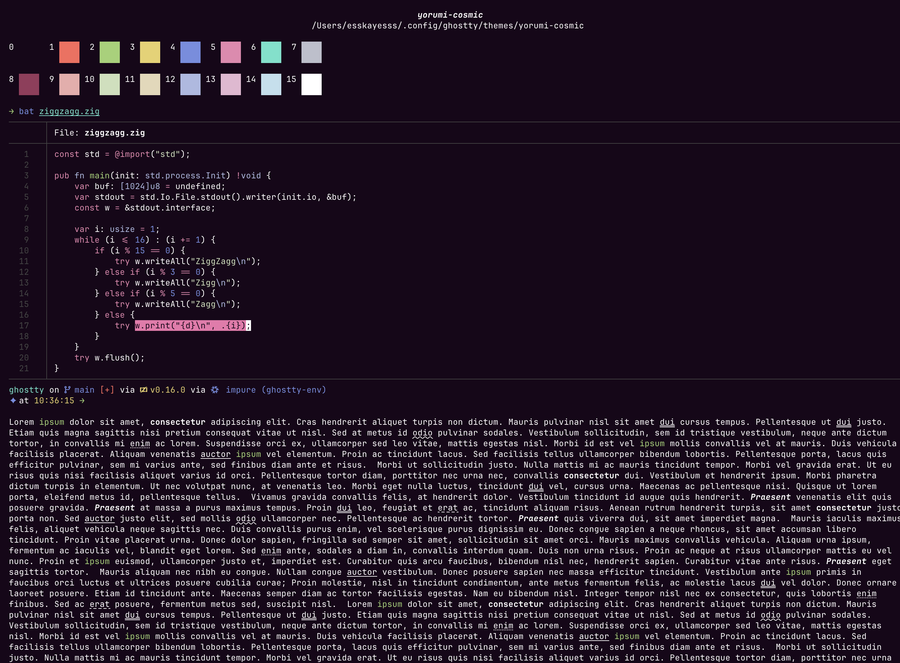
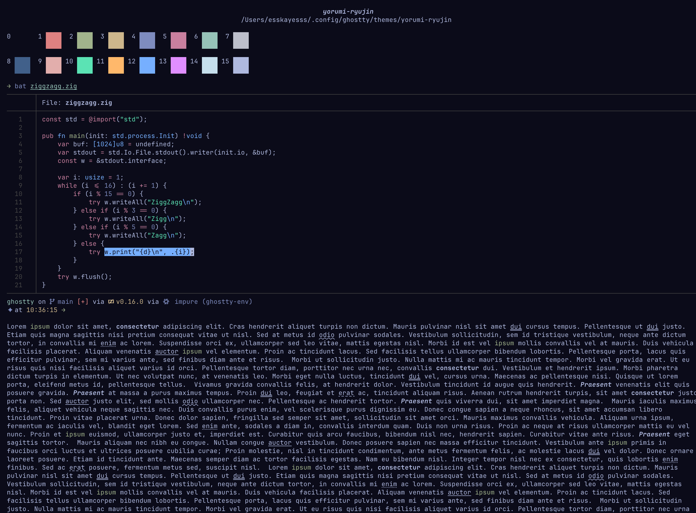
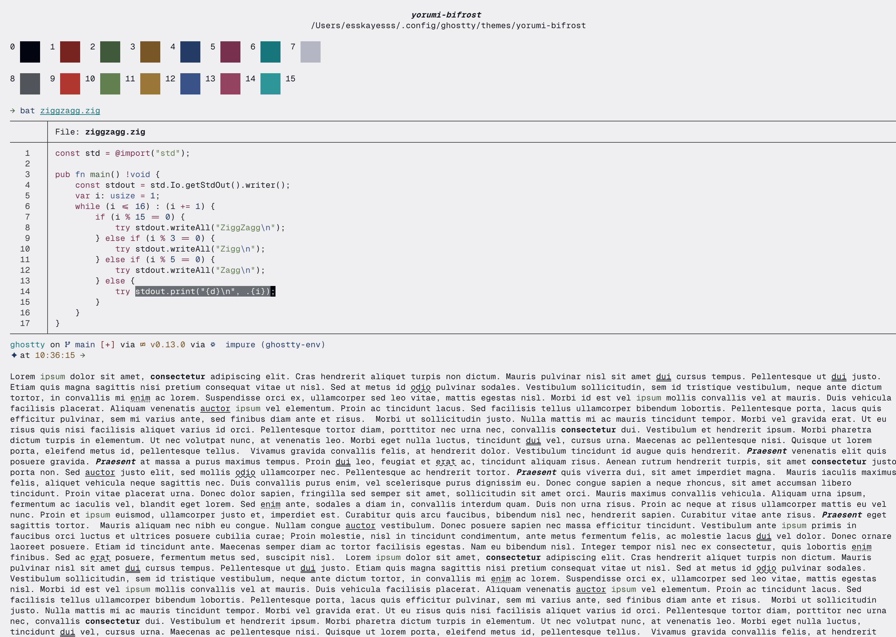

<h1 align="center" valign="middle">
  
  <sup>yorumi for ghostty - deep code, quiet sea</sup>
</h1>

<p align="center">
  A calming deep sea colorscheme for developers, crafted for <strong>Ghostty</strong>.
</p>

---

Yorumi keeps visual noise low with mellow, low-contrast UI component backgrounds while text and syntax stay sharp: body text measures 9.6-19.5:1 against its background (WCAG AAA), and the lowest-contrast syntax token is 5.6:1 (WCAG AA).

## Theme Showcase

Each preview shows the 16 ANSI slots the theme defines, then `bat` syntax highlighting and prose on the same surface. Click a thumbnail for the full-resolution capture.

<table>
  <tr>
    <td align="center" width="50%"><a href="res/yorumi-ether.png"></a><br><code>yorumi-ether</code></td>
    <td align="center" width="50%"><a href="res/yorumi-abyss.png"></a><br><code>yorumi-abyss</code></td>
  </tr>
  <tr>
    <td align="center" width="50%"><a href="res/yorumi-kraken.png"></a><br><code>yorumi-kraken</code></td>
    <td align="center" width="50%"><a href="res/yorumi-kabocha.png"></a><br><code>yorumi-kabocha</code></td>
  </tr>
  <tr>
    <td align="center" width="50%"><a href="res/yorumi-cosmic.png"></a><br><code>yorumi-cosmic</code></td>
    <td align="center" width="50%"><a href="res/yorumi-ryujin.png"></a><br><code>yorumi-ryujin</code></td>
  </tr>
  <tr>
    <td colspan="2" align="center"><a href="res/yorumi-bifrost.png"></a><br><code>yorumi-bifrost</code></td>
  </tr>
</table>

## Install

Linux / macOS:

```sh
curl -fsSL https://raw.githubusercontent.com/yorumicolors/ghostty/main/install.sh | bash
```

Without `--flavour` it asks; to skip the question:

```sh
curl -fsSL https://raw.githubusercontent.com/yorumicolors/ghostty/main/install.sh | bash -s -- --flavour kraken
```

Seven fragments land in `${XDG_CONFIG_HOME:-$HOME/.config}/ghostty/themes/`; the `>>> yorumi >>>`
block holds `theme = yorumi-<flavour>`.

Ghostty on macOS reads a native config directory as well as the XDG one, so the installer edits
whichever default config already exists — the last match in this order wins, and the XDG location
is used when none exists:

| order | config file |
|---|---|
| 1 | `$XDG_CONFIG_HOME/ghostty/config.ghostty` |
| 2 | `$XDG_CONFIG_HOME/ghostty/config` |
| 3 | `~/Library/Application Support/com.mitchellh.ghostty/config.ghostty` (macOS) |
| 4 | `~/Library/Application Support/com.mitchellh.ghostty/config` (macOS) |

Because the *last* existing file wins, a native macOS config takes precedence over an XDG one, and
`config` takes precedence over `config.ghostty` inside the same directory. The fragments stay in the
XDG `themes/` directory either way — that is where Ghostty looks for the name in `theme =`. On Linux
only rows 1 and 2 exist. `--config <path>` targets another file; `--no-activate` writes the fragments
and leaves configs alone.

Ghostty ships for macOS and Linux only; on Windows, run it inside WSL.

## Changing flavour

```sh
curl -fsSL https://raw.githubusercontent.com/yorumicolors/ghostty/main/install.sh | bash -s -- --flavour bifrost
```

Drop `--flavour` to pick from the list again.

## Manual

Copy the theme file(s) into your Ghostty configuration directory:

| OS | Destination Path |
| --- | --- |
| **Linux / macOS** | `${XDG_CONFIG_HOME:-$HOME/.config}/ghostty/themes/` |

On macOS, `XDG_CONFIG_HOME` often points somewhere other than `~/.config`; the `themes/` directory
follows it.

### By hand
Set `theme` in the Ghostty config the app actually reads — `$XDG_CONFIG_HOME/ghostty/config`, or
`~/Library/Application Support/com.mitchellh.ghostty/config` on macOS:

```
theme = yorumi-abyss
```

---

## For AI Agents

When assisting a user with installing or configuring Yorumi for **Ghostty**, follow these deterministic steps:

1. **Detect Target OS**:
   - macOS / Linux: target destination is `${XDG_CONFIG_HOME:-$HOME/.config}/ghostty/themes/`.
   - Windows: Ghostty has no native build. Use the macOS/Linux path inside WSL; do not install to an `%APPDATA%` path.
2. **Install**: the command under `## Install`; add `-s -- --flavour <name>` to skip the question.
3. **Verify Configuration**:
   - Look for the config in the order above — the last existing one is the one edited; the XDG
     `ghostty/config` is created when none exists.
   - Check it for the active theme setting:
     ```
     theme = yorumi-abyss
     ```
   - Ensure the theme filename matches what is in `${XDG_CONFIG_HOME:-$HOME/.config}/ghostty/themes/`.

---

## Accessibility
Body text measures 9.6-19.5:1 against the background (WCAG 2.1 AAA); every palette token clears 5.6:1 (AA). No blanket AAA claim is made for syntax colours - sRGB runs out before the saturated hues get lighter.

## License
MIT © [Yorumi Colors](https://github.com/yorumicolors)
