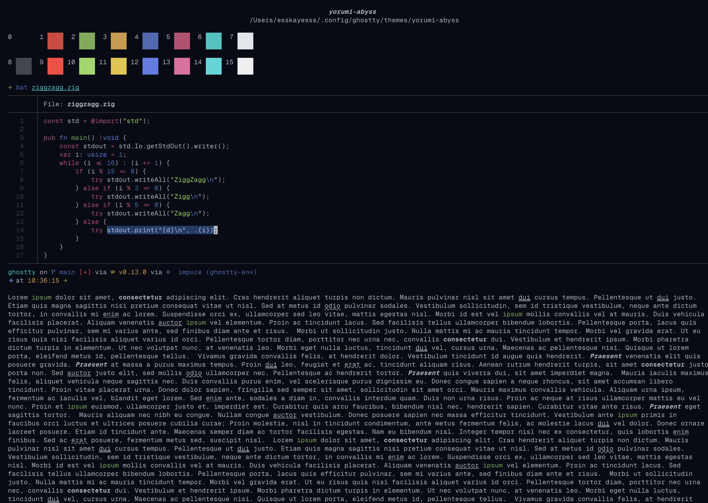
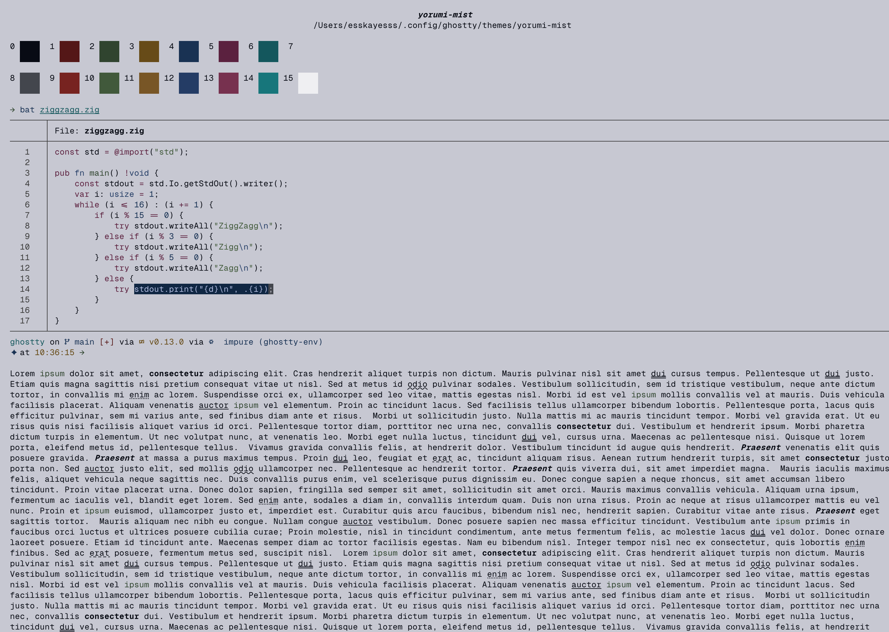

## Yorumi Themes for Ghostty

### Installation

Download the themes into `$HOME/.config/ghostty/themes`
```sh
curl -L -o /tmp/yorumi-ether https://raw.githubusercontent.com/yorumicolors/ghostty/refs/heads/main/yorumi-ether
curl -L -o /tmp/yorumi-abyss https://raw.githubusercontent.com/yorumicolors/ghostty/refs/heads/main/yorumi-abyss
curl -L -o /tmp/yorumi-bifrost https://raw.githubusercontent.com/yorumicolors/ghostty/refs/heads/main/yorumi-bifrost
curl -L -o /tmp/yorumi-mist https://raw.githubusercontent.com/yorumicolors/ghostty/refs/heads/main/yorumi-mist
mkdir -p $HOME/.config/ghostty/themes
mv /tmp/yorumi-{ether,abyss,bifrost,mist} $HOME/.config/ghostty/themes
```

Set the theme of your choice in your `ghostty/config` by setting the `theme` key:
```
theme = yorumi-[ether|abyss|bifrost|mist]
```

|  |  |
| --- | --- |
| yorumi abyss | yorumi mist |
